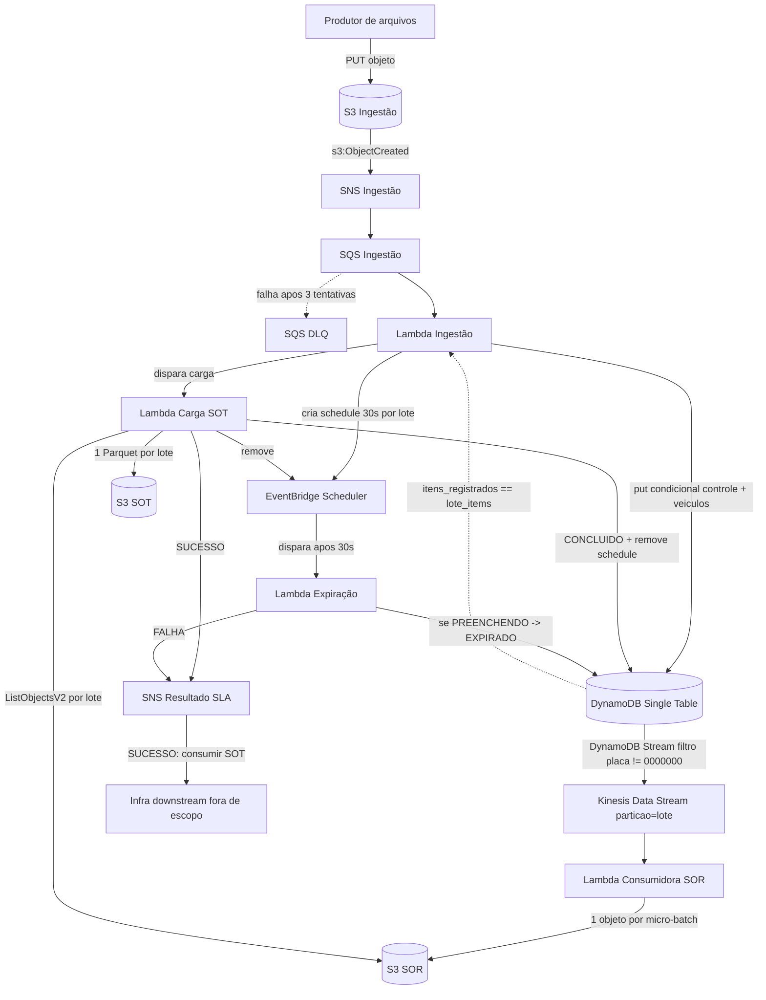
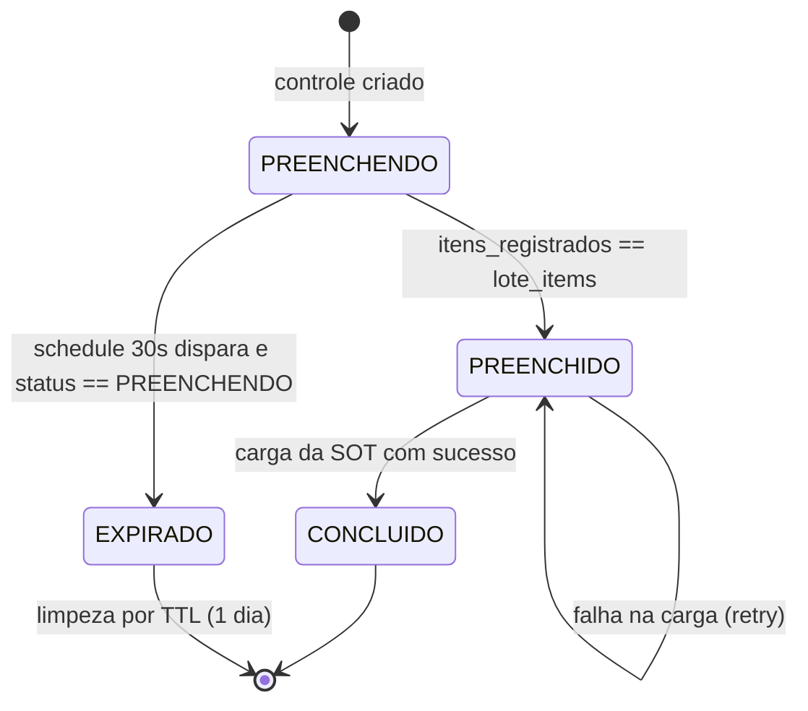
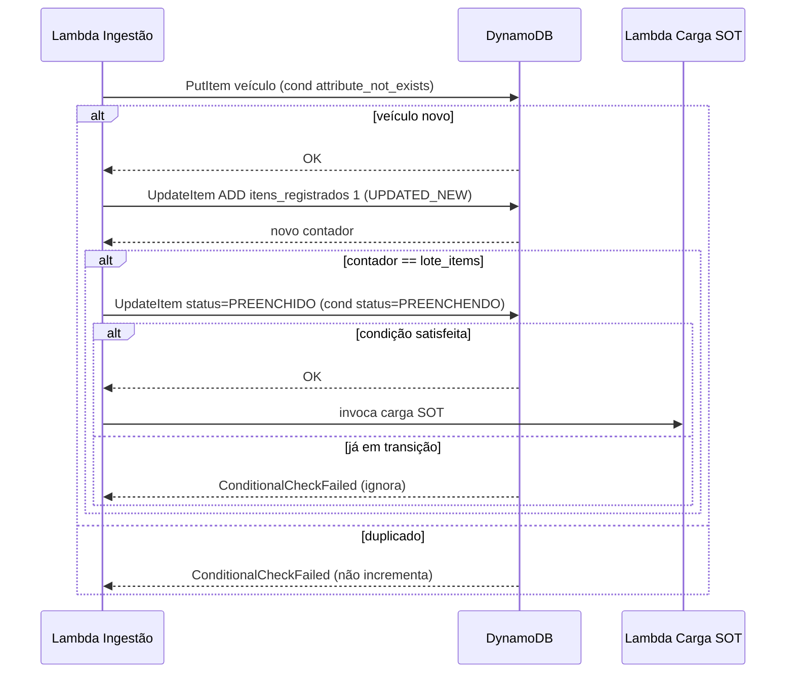

# Design — Processamento de Lotes de Veículos

## Stack e convenções

- **IaC:** Serverless Framework (`serverless.yml`). Recursos AWS nativos (buckets S3, SNS, SQS+DLQ,
  DynamoDB, Kinesis, EventBridge Scheduler) declarados no bloco `resources` (CloudFormation);
  as Lambdas no bloco `functions`.
- **Runtime das Lambdas:** Python (`python3.12`). Dependências empacotadas via
  `serverless-python-requirements` (com `dockerizePip` para compilar libs nativas como `pyarrow`).
- **Geração de Parquet:** `pyarrow` (ou `awswrangler`) na Lambda de Carga da SOT.
- **Testes:** `pytest` (unitários e integração); `moto` ou `localstack` para simular AWS onde aplicável.
- **Devcontainer:** a estrutura de devcontainer segue um padrão já definido pelo time e é montada à parte
  (fora do escopo desta Spec).

### Estrutura de projeto (proposta)
```
.
├── serverless.yml
├── requirements.txt
├── src/
│   ├── ingestao/handler.py          # Lambda Ingestão
│   ├── sor_consumer/handler.py      # Lambda Consumidora SOR
│   ├── carga_sot/handler.py         # Lambda Carga SOT (pyarrow)
│   ├── expiracao/handler.py         # Lambda Expiração (SLA)
│   └── common/                      # parsing posicional, acesso DynamoDB, modelos
└── tests/
```

## Visão geral

O sistema ingere arquivos posicionais do S3, grava cada veículo em uma tabela DynamoDB (Single Table Design)
mantendo um registro de controle por lote, e materializa os dados de lotes completos em uma camada analítica
(SOT) em Parquet. O caminho analítico é desacoplado da tabela OLTP por meio de DynamoDB Stream → Kinesis →
camada SOR (S3), evitando leituras onerosas no DynamoDB para lotes grandes. Um SLA de 30s por lote é
controlado via EventBridge Scheduler, e o resultado (sucesso/falha) é notificado por SNS.

## Arquitetura



## Componentes

### S3 Ingestão
Bucket que recebe os arquivos txt. Configurado com notificação `s3:ObjectCreated:*` para o SNS de ingestão.

### SNS Ingestão + SQS + DLQ
- SNS desacopla o evento do bucket do consumidor.
- SQS é a fonte de eventos (event source mapping) da Lambda de ingestão.
- DLQ com `maxReceiveCount = 3` isola mensagens não processáveis (arquivo inacessível, key inexistente, erro de runtime).

### Lambda Ingestão
Responsável por ler o arquivo, parsear as linhas por layout posicional, agrupar por lote e persistir no DynamoDB.

Pseudocódigo do núcleo:
```
registros = parse(arquivo)                     # descarta linhas malformadas silenciosamente
por_lote = group_by(registros, lote)
para cada (lote, linhas) em por_lote:
    lote_items = linhas[0].lote_items
    # cria controle se não existir + agenda SLA
    criou = put_item_condicional(
        PK=lote, SK='0000000',
        lote_items=lote_items, itens_registrados=0, status='PREENCHENDO',
        ttl=now+1d,
        cond=attribute_not_exists(PK) AND attribute_not_exists(SK))
    se criou:
        criar_schedule(id=lote, delay=30s)     # EventBridge Scheduler

    para cada linha em linhas:
        inserido = put_item_condicional(
            PK=lote, SK=linha.placa,
            modelo, fabricante, ano_fabricacao, ttl=now+1d,
            cond=attribute_not_exists(PK) AND attribute_not_exists(SK))
        se inserido:
            novo = update_item(PK=lote, SK='0000000',
                               expr="ADD itens_registrados :um", :um=1,
                               return=UPDATED_NEW).itens_registrados
            se novo == lote_items:
                marcar_preenchido_e_concluir(lote)   # ver abaixo
```

### Conclusão do lote (transição única)
```
marcar_preenchido_e_concluir(lote):
    ok = update_item(PK=lote, SK='0000000',
                     set status='PREENCHIDO',
                     cond=status = 'PREENCHENDO')     # só uma execução passa
    se não ok: return                                 # outra execução já conduz
    invocar Lambda Carga SOT (lote)
```
A carga da SOT roda de forma assíncrona (invocação da Lambda Carga SOT). A transição para `CONCLUIDO` ocorre
somente após o sucesso da materialização.

### DynamoDB (Single Table Design)
- **PK:** lote. **SK:** placa (`0000000` para o registro de controle).
- **Registro de controle:** `lote_items`, `itens_registrados`, `status`, `ttl`.
- **Registro de veículo:** `modelo`, `fabricante`, `ano_fabricacao`, `ttl`.
- **TTL:** 1 dia.
- **DynamoDB Stream:** habilitado (NEW_IMAGE). Filtro para excluir eventos com SK=`0000000`
  (filtro no event source mapping do Stream, se suportado; caso contrário, filtra na Lambda consumidora).

Exemplo de itens:
| PK (lote) | SK (placa) | lote_items | itens_registrados | status      | modelo | fabricante | ano_fabricacao |
|-----------|------------|------------|-------------------|-------------|--------|------------|----------------|
| 000123    | 0000000    | 50         | 37                | PREENCHENDO | -      | -          | -              |
| 000123    | ABC1234    | -          | -                 | -           | GOL    | VW         | 2020           |

### Kinesis Data Stream
- Consome o DynamoDB Stream (via EventBridge Pipe ou Lambda de forwarding, conforme decisão de implementação).
- **Partition key:** ID do lote (garante ordenação e localidade por lote).
- Não recebe eventos do registro de controle (`0000000`).

### Lambda Consumidora SOR
- Lê micro-batches do Kinesis.
- Grava **1 objeto por micro-batch** em `sor/lote=<LOTE>/<timestamp>-<uuid>.json` (append-only, sem read-modify-write).
- Como o Kinesis particiona por lote, cada micro-batch tende a conter registros de um único lote.

### Lambda Carga SOT
- Acionada pela conclusão do lote.
- `ListObjectsV2` em `sor/lote=<LOTE>/`, lê e consolida os registros de veículos.
- Valida `count(registros) == lote_items` antes de materializar (trata a consistência eventual da SOR).
- Grava `sot/lote=<LOTE>/dados.parquet` com colunas `lote, placa, ano_fabricacao, modelo, fabricante`.
- Em sucesso: marca `CONCLUIDO`, remove o schedule e publica SUCESSO no SNS de resultado.
- Em falha: mantém `PREENCHIDO` (permite retry).

### EventBridge Scheduler + Lambda Expiração
- Um schedule one-time de 30s por lote, ID = lote.
- No disparo, a Lambda Expiração lê o status: se `PREENCHENDO` → `EXPIRADO` + publica FALHA no SNS;
  se `PREENCHIDO`/`CONCLUIDO` → não faz nada.

### SNS Resultado SLA
- SUCESSO (lote CONCLUIDO): ponto de integração para a infra downstream consumir a SOT.
- FALHA (lote EXPIRADO): visibilidade de descumprimento de SLA.

## Máquina de estados do lote



## Fluxo de inserção concorrente



## Decisões de design e trade-offs

- **SOR intermediária (vs. ler DynamoDB direto):** evita carga de leitura ofensiva na tabela OLTP para
  lotes grandes e dá durabilidade além do TTL. Custo: complexidade e consistência eventual (mitigada pela
  validação de contagem na carga da SOT).
- **1 objeto por micro-batch na SOR (estratégia A2):** evita read-modify-write (sem perda por concorrência)
  e reduz small files em relação a 1 objeto por veículo, mantendo localidade por lote. Small files residuais
  ficam confinados à SOR e são limpos por lifecycle.
- **Duas operações separadas (vs. TransactWriteItems):** menor custo/complexidade; trade-off é um pequeno
  risco de inconsistência se a Lambda falhar entre inserir o veículo e incrementar o contador. Aceitável para POC.
- **Transição PREENCHIDO antes de CONCLUIDO:** separa "todos os dados no DynamoDB" de "SOT materializada",
  permitindo retry da carga sem reprocessar a ingestão e evitando expirar um lote cujos dados chegaram no prazo.

## Riscos e pontos de atenção

- **Consistência SOR × conclusão:** registros podem estar em trânsito quando a conclusão dispara;
  a carga da SOT valida contagem e aguarda/reprocessa.
- **SLA com múltiplos arquivos:** linhas do mesmo lote em arquivos distantes >30s podem expirar o lote
  antes de completar — aceito como decisão de negócio.
- **Falha entre inserir veículo e incrementar contador:** pode deixar o contador abaixo do real;
  consequência é o lote não concluir e expirar. Aceitável para POC.
