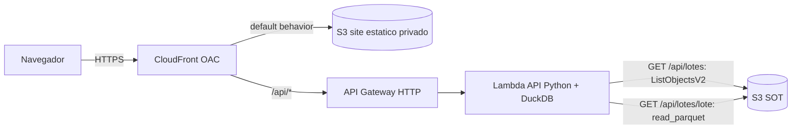

# Design — Visualização da POC

## Visão geral

Camada de apresentação somente-leitura que expõe o resultado consolidado (SOT) por uma URL pública.
Um site estático (S3 privado + CloudFront com OAC) oferece uma dropdown de lotes e uma tabela de veículos.
Os dados vêm de uma API serverless (API Gateway HTTP + Lambda Python com DuckDB) que consulta os Parquet da SOT.
Front e API ficam sob o mesmo domínio CloudFront, eliminando CORS.

## Stack e convenções
- **IaC:** adicionado ao **mesmo `serverless.yml`** do core (novas `functions` e `resources`).
- **Runtime da Lambda API:** `python3.12`; DuckDB via layer ou `serverless-python-requirements` (`dockerizePip`).
- **Front:** estático (HTML + JS vanilla), publicado no bucket S3 do site.
- **DuckDB:** leitura de Parquet no S3 (`httpfs`), consultas SQL sob demanda.

## Arquitetura



## Componentes

### CloudFront + S3 estático (OAC)
- Distribuição com duas origens: o bucket S3 do site (default behavior) e o API Gateway (behavior `/api/*`).
- Bucket do site **privado**, acessível somente pelo CloudFront via Origin Access Control.
- Comportamento de cache: estáticos cacheáveis; `/api/*` com cache desabilitado (ou TTL curto).

### API Gateway (HTTP API)
- Rotas: `GET /api/lotes` e `GET /api/lotes/{lote}`, ambas integradas à Lambda API.

### Lambda API (Python + DuckDB)
```
GET /api/lotes:
    prefixos = s3.list_objects_v2(Bucket=SOT, Prefix='sot/lote=', Delimiter='/').CommonPrefixes
    lotes = [extrai_id(p) for p in prefixos]   # 'sot/lote=000123/' -> '000123'
    return 200, lotes

GET /api/lotes/{lote}:
    valida_lote(lote)                          # regex ^[A-Za-z0-9]+$ (evita path/SQL injection)
    key = f"s3://{SOT}/sot/lote={lote}/dados.parquet"
    se not objeto_existe(key): return 404
    con = duckdb.connect()
    con.execute("INSTALL httpfs; LOAD httpfs;")
    rows = con.execute(
        "SELECT lote, placa, ano_fabricacao, modelo, fabricante FROM read_parquet(?)",
        [key]).fetchall()
    return 200, to_json(rows)
```
Notas:
- O parâmetro `{lote}` é validado por allowlist (apenas alfanumérico) e passado como **parâmetro** da query
  (`read_parquet(?)`), nunca concatenado, evitando injeção.
- Credenciais do DuckDB para S3 vêm da role da Lambda (provider chain), não hardcoded.

### Front estático
- `index.html` + `app.js` (vanilla): no load chama `/api/lotes` e popula a dropdown; na seleção/botão "Atualizar"
  chama `/api/lotes/{lote}` e renderiza a tabela. Exibe estados de carregando e vazio.

## Decisões de design
- **DuckDB na leitura (vs. PyArrow):** a API consulta Parquet sob demanda com SQL; DuckDB lê direto do S3
  (`httpfs`) e é conciso para `SELECT`. Complementa o uso de PyArrow na **escrita** da SOT (core).
- **Mesmo domínio via CloudFront:** evita CORS e entrega HTTPS/URL pública com S3 privado (OAC), adequado
  para demonstração externa.
- **Sem auto-refresh:** a SOT é estável após a conclusão do lote; atualização sob demanda é suficiente e mais barata.

## Riscos e pontos de atenção
- **Cold start do DuckDB + `httpfs`:** primeira invocação instala/carrega a extensão; mitigar empacotando a
  extensão no layer ou mantendo a Lambda aquecida para a demo.
- **Latência de leitura S3:** aceitável para o volume da POC (centenas de registros por lote, 1 arquivo por lote).
- **Dados ausentes:** lotes só aparecem após CONCLUIDO (SOT gerada); lotes EXPIRADOS não aparecem — comportamento esperado.
