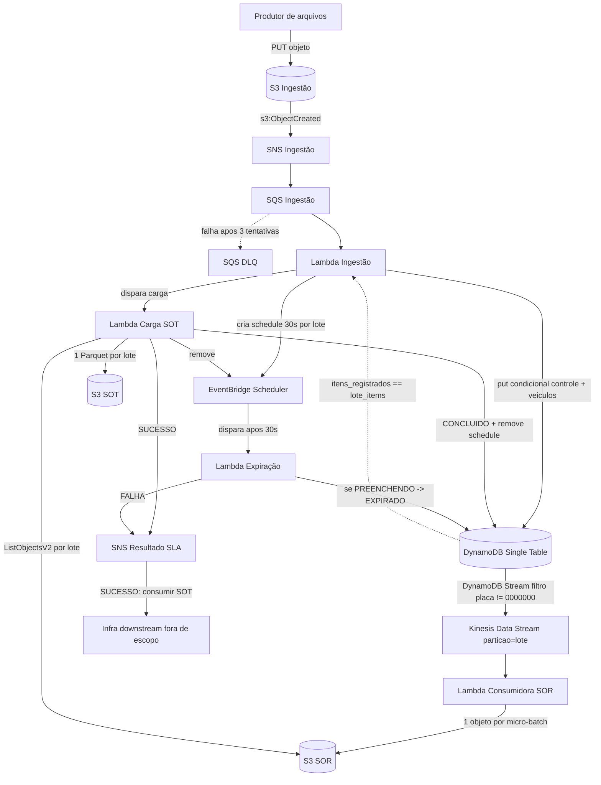
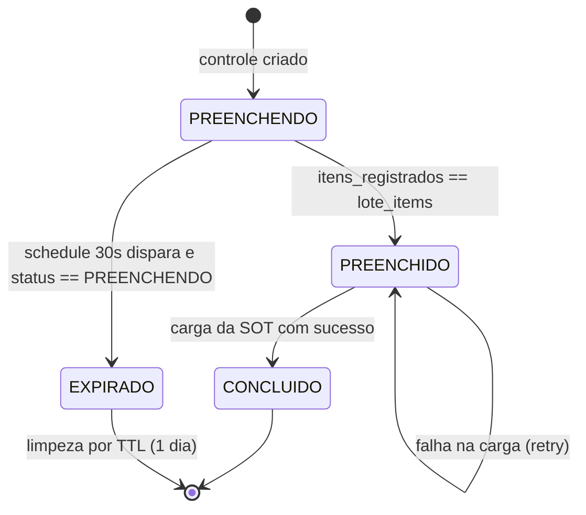
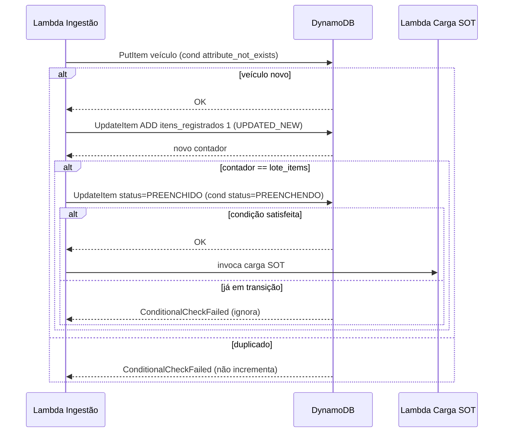
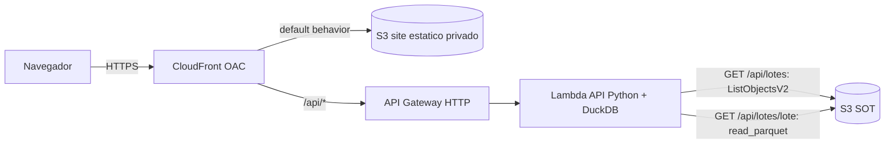

# POC — Processamento de Lotes de Veículos

Pipeline serverless na AWS que ingere arquivos de texto posicionais com registros de veículos
agrupados por lote, acompanha o progresso de preenchimento de cada lote, materializa os lotes
concluídos em uma camada analítica (SOT em Parquet) e expõe o resultado em uma página web pública.

O processamento de cada lote tem um **SLA de 30 segundos**; o resultado (sucesso ou falha) é
notificado via SNS. A geração dos arquivos não é confiável (podem ser reenviados e as linhas de
um mesmo lote podem chegar em arquivos diferentes), portanto o sistema é **idempotente** e
tolerante a duplicidades.

## Sumário
- [Arquitetura](#arquitetura)
- [Ciclo de vida do status do lote](#ciclo-de-vida-do-status-do-lote)
- [Fluxo de inserção concorrente](#fluxo-de-inserção-concorrente)
- [Camada de visualização](#camada-de-visualização)
- [Layout posicional do registro](#layout-posicional-do-registro)
- [Modelo de dados (DynamoDB)](#modelo-de-dados-dynamodb)
- [Camadas de dados: SOR e SOT](#camadas-de-dados-sor-e-sot)
- [Stack e estrutura do projeto](#stack-e-estrutura-do-projeto)
- [Deploy](#deploy)
- [Testes](#testes)
- [Como testar o fluxo](#como-testar-o-fluxo)
- [Decisões de design](#decisões-de-design)

## Arquitetura



Fluxo resumido:
1. Um arquivo é depositado no bucket S3 de ingestão → notifica o SNS → entrega na SQS → aciona a **Lambda de Ingestão**.
2. A Lambda parseia as linhas (descarte silencioso de malformadas), agrupa por lote e, para cada lote,
   garante o registro de controle (condicional) e cria um schedule de 30s (SLA).
3. Cada veículo é inserido de forma idempotente e incrementa atomicamente o contador do lote.
4. O DynamoDB Stream propaga as inserções (exceto o registro de controle) para o Kinesis, particionado por lote.
5. A **Lambda Consumidora SOR** grava 1 objeto por micro-batch na camada SOR (S3).
6. Ao completar (`itens_registrados == lote_items`), o lote vira `PREENCHIDO` e dispara a **Lambda de Carga da SOT**,
   que consolida a SOR em 1 Parquet por lote, marca `CONCLUIDO`, remove o schedule e notifica SUCESSO.
7. Se o SLA de 30s estourar com o lote ainda em `PREENCHENDO`, a **Lambda de Expiração** marca `EXPIRADO` e notifica FALHA.

## Ciclo de vida do status do lote



A cada transição, o registro de controle grava um atributo `ts_<STATUS>` com o epoch do momento
(`ts_PREENCHENDO`, `ts_PREENCHIDO`, `ts_CONCLUIDO`, `ts_EXPIRADO`), permitindo medir a latência entre estados.

## Fluxo de inserção concorrente



## Camada de visualização

Página web pública (somente leitura) que ilustra o resultado consolidado. Front estático em S3 privado,
distribuído por CloudFront (OAC), e API serverless (API Gateway HTTP + Lambda Python) que consulta os
Parquet da SOT. Front e API ficam sob o mesmo domínio CloudFront (sem CORS).



Endpoints:
- `GET /api/lotes` — lista os IDs de lote disponíveis na SOT (via `ListObjectsV2`).
- `GET /api/lotes/{lote}` — veículos do lote. A Lambda baixa o Parquet da SOT para `/tmp` e lê com DuckDB.

## Layout posicional do registro

Índices base-0, ambas as pontas inclusivas. Cada linha tem 61 caracteres.

| Campo          | Posições | Tamanho |
|----------------|----------|---------|
| LOTE           | 0-5      | 6       |
| LOTE-ITEMS     | 6-9      | 4       |
| PLACA          | 10-16    | 7       |
| ANO FABRICACAO | 17-20    | 4       |
| MODELO         | 21-40    | 20      |
| FABRICANTE     | 41-60    | 20      |

- `LOTE-ITEMS` (quantidade total de veículos do lote) é repetido em todas as linhas do lote.
- A placa ocupa 7 posições; placas válidas nunca são `0000000`, reservado ao registro de controle.

## Modelo de dados (DynamoDB)

Single Table Design: **PK = lote**, **SK = placa**.

| PK (lote) | SK (placa) | lote_items | itens_registrados | status      | modelo | fabricante | ano_fabricacao | ts_*        |
|-----------|------------|------------|-------------------|-------------|--------|------------|----------------|-------------|
| 000123    | 0000000    | 50         | 37                | PREENCHENDO | -      | -          | -              | epoch(s)    |
| 000123    | ABC1234    | -          | -                 | -           | GOL    | VW         | 2020           | -           |

- **Registro de controle** (SK `0000000`): mantém `lote_items`, `itens_registrados`, `status` e os `ts_<STATUS>`.
- **Registro de veículo**: `modelo`, `fabricante`, `ano_fabricacao`.
- **TTL**: 1 dia em todos os itens.
- **DynamoDB Stream** (NEW_IMAGE) propaga as inserções para o Kinesis; o registro de controle é filtrado.

## Camadas de dados: SOR e SOT

```
DynamoDB Stream → Kinesis Data Stream → Lambda Consumidora → SOR (S3) → Lambda Carga → SOT (S3)
```

- **SOR** (bruto): 1 objeto por micro-batch do Kinesis, particionado por lote (`sor/lote=<LOTE>/...`),
  sem read-modify-write. Lifecycle de expiração curta. Evita leitura ofensiva no DynamoDB para lotes grandes.
- **SOT** (consolidado): 1 Parquet por lote (`sot/lote=<LOTE>/dados.parquet`) com as colunas
  `lote, placa, ano_fabricacao, modelo, fabricante`. A carga valida `contagem == lote_items` antes de materializar.

## Stack e estrutura do projeto

- **IaC**: Serverless Framework (`serverless.yml`).
- **Runtime**: Python 3.12. Dependências de runtime empacotadas via `serverless-python-requirements`.
- **Parquet**: `pyarrow` (escrita, na carga da SOT). **DuckDB**: leitura (API de visualização).
- **Testes**: `pytest` + `moto`.

```
.
├── serverless.yml
├── requirements.txt            # dependências de runtime (Lambdas)
├── requirements-dev.txt        # dependências de teste
├── pytest.ini
├── src/
│   ├── common/                 # parsing, repository (DynamoDB), scheduler, constants
│   ├── ingestao/               # Lambda de ingestão
│   ├── sor_consumer/           # Lambda consumidora SOR (Kinesis -> S3)
│   ├── carga_sot/              # Lambda de carga da SOT (SOR -> Parquet)
│   ├── expiracao/              # Lambda de expiração (SLA)
│   └── api/                    # Lambda da API de visualização (DuckDB)
├── web/                        # front estático (index.html, app.js, styles.css)
├── lotes/                      # arquivos de massa de teste
└── tests/                      # testes (pytest + moto)
```

## Deploy

Pré-requisitos no ambiente de deploy:
- Node + Serverless Framework e os plugins:
  ```bash
  npm install -D serverless-python-requirements serverless-iam-roles-per-function
  ```
- Credenciais AWS configuradas. Região padrão: `sa-east-1`.

Como as dependências nativas (`pyarrow`, `duckdb`) são empacotadas sem Docker, o `serverless.yml`
força o download de wheels manylinux pré-compilados (via `pipCmdExtraArgs`).

```bash
# deploy completo
npx serverless deploy --stage HML

# deploy de uma função específica (apenas código em src/)
npx serverless deploy function --function api --stage HML
```

Observações:
- Os nomes de bucket usam um identificador em minúsculas (`bucketStage`, default `hml`), pois o S3
  não aceita maiúsculas; o stage da stack pode ser `HML`.
- A publicação dos estáticos do site **não** é automática no deploy:
  ```bash
  aws s3 sync web/ s3://poc-lotes-veiculos-hml-site/ --region sa-east-1
  ```
- A URL pública é exibida no output `SiteUrl` ao final do deploy.

## Testes

```bash
python -m pytest
```

Cobrem: parser posicional, repositório DynamoDB (idempotência, contador atômico, transições e timestamps),
ingestão (fluxo completo, reenvio idempotente, múltiplos lotes por arquivo), consumidora SOR, carga da SOT
(sucesso, incompletude/retry, dedup), expiração (os três estados), scheduler (expressão one-time) e API.

## Como testar o fluxo

1. Publique os estáticos (uma vez): `aws s3 sync web/ s3://poc-lotes-veiculos-hml-site/ --region sa-east-1`
2. Envie um arquivo de massa:
   ```bash
   aws s3 cp lotes/massa_teste.txt s3://poc-lotes-veiculos-hml-ingestao/ --region sa-east-1
   ```
3. Acompanhe:
   - DynamoDB: status do lote evoluindo PREENCHENDO → PREENCHIDO → CONCLUIDO.
   - SOT: `aws s3 ls s3://poc-lotes-veiculos-hml-sot/sot/ --recursive --region sa-east-1`
   - Visualização: abra a URL do CloudFront e selecione o lote na dropdown.

Arquivos de massa inclusos em `lotes/`:
- `massa_teste.txt` — 2 lotes (5 e 10 veículos) que concluem.
- `massa_teste_expira.txt` — 1 lote incompleto (expira após 30s).
- `massa_teste_1000.txt` — 1000 registros em 6 lotes (um com 120 veículos) para teste de volumetria.

## Decisões de design

- **SOR intermediária** (vs. ler o DynamoDB direto): evita carga de leitura ofensiva na tabela OLTP para
  lotes grandes e dá durabilidade além do TTL. Consistência eventual mitigada pela validação de contagem na carga.
- **1 objeto por micro-batch na SOR**: sem read-modify-write (sem perda por concorrência) e menos small files
  do que 1 objeto por veículo, mantendo a localidade por lote.
- **Duas operações separadas** (insert condicional + `ADD` atômico) em vez de transação: menor custo/complexidade,
  com pequeno risco de inconsistência aceitável para POC.
- **Transição PREENCHIDO → CONCLUIDO**: separa "todos os dados no DynamoDB" de "SOT materializada", permitindo
  retry da carga e evitando expirar um lote cujos dados chegaram no prazo.
- **PyArrow para escrever / DuckDB para ler**: cada ferramenta no seu ponto forte. A API baixa o Parquet para
  `/tmp` e lê localmente (evita dependência de `httpfs`/rede/home directory no Lambda).

---

As especificações completas (requisitos, design e tarefas) estão em `.kiro/specs/`:
- `processamento-lotes-veiculos/` — pipeline core.
- `visualizacao-poc/` — camada de apresentação.
